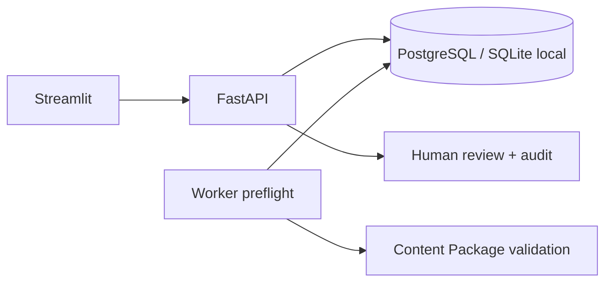

# Foundation

ContentPackage v1 là hợp đồng Pydantic chung: branch, title, language, sources và scenes.
Research bắt buộc mỗi scene có ít nhất một source index; việc có tham chiếu không chứng minh
nội dung đúng, vẫn cần fact-check và người duyệt. Schema cấm trường lạ để phát hiện lệch hợp đồng.

Job giữ scenes gốc; phần `video_content` có thể sửa bằng API content và giao diện soạn thảo.
Sửa nội dung bỏ trạng thái approved và đưa về awaiting_review; giữ analysis gốc cùng cờ
`edited_after_analysis`, không crawl lại. Content hash ngăn ghi đè bản khác.
API dùng UUID, phân trang, idempotency key và optimistic locking khi duyệt.
Worker claim bằng conditional UPDATE; chỉ worker claim thành công mới xử lý.
Mỗi chuyển trạng thái và audit event commit cùng transaction.

SQLite giúp chạy local không cần Docker. PostgreSQL là mục tiêu triển khai dùng chung.
Migration dùng kiểu JSON chuẩn để tương thích hai DB. Không tự tạo bảng lúc API boot;
health trả 503 nếu migration chưa được áp dụng.

Phase 1 worker tải nguồn HTTP/HTTPS bằng transport chung, pin IP công khai sau DNS,
giữ Host/TLS SNI, xác thực từng redirect, giới hạn kích thước/thời gian, phát hiện encoding.
Trafilatura trích xuất main text; không selector/domain riêng. Không render JavaScript.
Source documents được commit trước analysis. Adapter AI gọi provider được cấu hình;
output phải qua schema summary/key_points/video_content. Chỉ sau khi analysis thành công
mới chuyển awaiting_review. Thiếu model/key, HTTP lỗi hay JSON sai đều failed tại Phase 1.
Không thay bằng preflight khi AI lỗi. Retry analysis dùng lại source documents.

Phase 2 đọc nội dung đã hoàn tất Phase 1, cho chỉnh sửa, duyệt và tải TXT. Không fetch URL.
Nhập tay là luồng riêng cho kịch bản đã chuẩn bị: dùng structural preflight, nhãn rõ không AI.
Các capabilities chưa nối vẫn trả not_configured. Crawl4AI chưa cài và chưa được tích hợp;
crawler hiện tại là HTTP + Trafilatura, không mô tả nó thành browser crawler.

Worker local là một supervisor; claim job rồi tạo tiến trình con cho job đó. API cancel:
queued → cancelled, running → cancelling. Supervisor poll 0,2 giây, terminate tiến trình
con đã tạo, kill nếu không thoát sau 3 giây, wait thu hồi process rồi xác nhận cancelled.
Không nhận PID từ client hay kill PID tùy ý. Checkpoint và optimistic locking ngăn child
ghi đè cancelled thành kết quả thành công/failed. Khi startup, supervisor phục hồi trạng
thái running/cancelling bị ngắt. Chỉ hỗ trợ một supervisor local.

Workspace đọc endpoint riêng: toàn bộ job active cùng 20 job kết thúc gần nhất,
không bị giới hạn 50 job của danh sách nội dung. Streamlit fragment cập nhật mỗi 2 giây
để không làm mất nội dung đang soạn trong luồng chính.

Giới hạn hiện tại: chưa có lease phân tán hoặc multi-supervisor; chưa có multi-user auth,
ngân sách tháng, ingestion file TXT/EPUB hoặc publish. Có upload ảnh theo tác vụ và dựng MP4;
chi tiết cùng bước duyệt video nằm trong [video-pipeline.md](video-pipeline.md).
Không sử dụng trực tiếp làm dịch vụ public.

Thiết kế mục tiêu cho lớp đánh giá, feedback, benchmark và cải thiện theo phiên bản nằm ở
[quality-learning-plan.md](quality-learning-plan.md). Đây là kế hoạch, chưa phải khả năng runtime.
