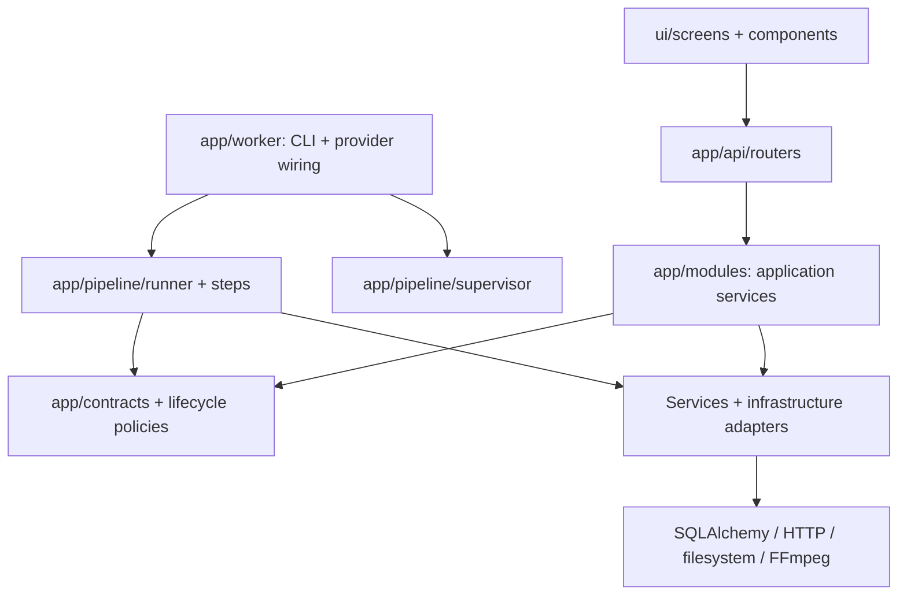
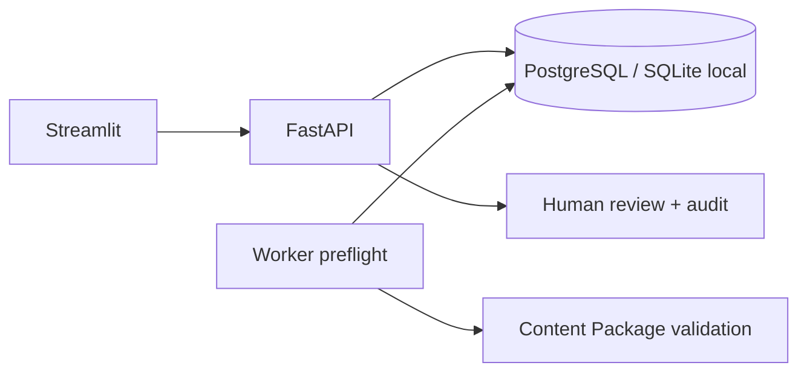

# Kiến trúc module

Ứng dụng là modular monolith: API, UI và worker vẫn chạy thành các process như trước,
chia sẻ contract và nghiệp vụ trong cùng repository. Phần local media bổ sung migration `0005` và API assets; các API cũ giữ tương thích. Không cần Redis, broker hoặc microservice cho single-supervisor hiện tại.

## Ranh giới trách nhiệm

- `app/main.py`: ASGI entrypoint, giữ `app` và `create_app` tương thích.
- `app/bootstrap.py`: tạo engine/session factory, đăng ký router và ánh xạ application error.
- `app/api/`: HTTP validation, authentication, dependency injection và file responses.
- `app/modules/`: use case theo jobs, content, production, quality, publishing, settings.
  Service không import FastAPI hoặc UI. Session là dependency bắt buộc, truyền bằng keyword.
- `app/modules/jobs/policies.py`: quyết định lifecycle dùng chung; không thực hiện I/O.
- `app/contracts/`: narration/hash, caption splitting/timestamp, artifact metadata và lỗi media.
- `app/pipeline/`: claim/cancel, process supervision và pipeline execution có trách nhiệm riêng.
  `steps/content.py` sở hữu ingestion và analysis; runner sở hữu kết quả cuối và failure handling.
- `app/infrastructure/persistence/`: SQLAlchemy mapping/engine và adapter lookup learned style.
- `app/infrastructure/media/`: subprocess, speech, frame layout, artifact inputs và encoding/QA.
- `app/services/`: các adapter AI/crawler/style hiện có; `video.py` là compatibility facade.
  `app/db.py` cũng giữ exports cho migrations, scripts và integrations cũ.
- `ui/studio.py`: composition root. `ui/screens` sở hữu widget từng phase;
  `ui/components` chứa Workspace, activity/quality panel và production progress;
  `ui/state` quản lý selection/navigation; `ui/client` gọi API.
  UI không import `app` hoặc đọc/ghi cấu hình backend trực tiếp.

Không tạo generic repository hay event bus cho mọi thao tác CRUD. SQLAlchemy Session là
unit of work hiện tại: application service sở hữu commit/rollback; query có thể viết trực tiếp
trong service khi chưa cần thay persistence adapter. Tách abstraction khi có cách dùng thay thế
hoặc logic cần dùng lại, không tạo lớp chỉ để bọc một lời gọi.

## Thay thế provider và tái sử dụng

`PipelineDependencies` nhận crawler, analyser, preflight và renderer từ worker composition root.
`MediaAdapters` nhận speech synthesizer, frame generator và command runner. Test hoặc provider
mới có thể truyền implementation khác mà không sửa supervisor hoặc workflow nội dung.
Caption layout được dùng chung giữa benchmark, quality checks và renderer.

Comic/Novel/Research tiếp tục dùng `ContentPackage` và workflow chung; prompt, style và policy
là điểm khác biệt. Không nhân bản ba pipeline chỉ theo tên nhánh.

## Transaction và hợp đồng cần giữ

- Mỗi thay đổi trạng thái và audit event liên quan commit cùng transaction.
- Pipeline commit theo checkpoint; không bọc cả pipeline trong một transaction lớn.
- Nguồn được lưu trước khi gọi analysis; retry tiếp tục dùng snapshot đã lưu.
- Transaction đọc trạng thái được kết thúc trước mỗi lần crawler gọi HTTP.
- Cancel kiểm tra trước/sau external operation; optimistic version guard ngăn kết quả muộn
  ghi đè trạng thái cancel. Supervisor chỉ dừng process con do nó tạo.
- Sửa content hủy hiệu lực approval/render; review kiểm tra content/video hash hiện hành.
- Giữ thuật toán hash narration hiện tại để dữ liệu cũ và request đang có vẫn tương thích.
- Style của render được chốt trong config; API dùng session hiện hành để tìm learned style,
  không tạo engine riêng cho mỗi yêu cầu render. Caller standalone vẫn có đường tương thích.

## Hiệu năng và kiểm tra ranh giới

Workspace lấy active jobs, tối đa 20 job kết thúc và latest events theo lô: 3 SELECT khi có job,
không thêm query theo từng job. UI dùng một jobs snapshot cho các screen trong mỗi lần rerun,
không cache dữ liệu review lâu dài. Các fragment vẫn tự refresh theo nhịp cũ.

`tests/test_refactor.py` kiểm tra query count với 1 và 101 active jobs, latest-event correctness,
settings API không trả secret, giữ key khi để trống, dùng đúng cấu hình từng app và authentication.
Test dependency boundary chặn UI import backend, application module import HTTP/UI và contract
import framework/persistence. Bộ test nghiệp vụ hiện có tiếp tục kiểm tra retry, cancel, revision,
review, migration và dựng video thật. Browser tests nằm trong `e2e/`.

Lệnh chạy không đổi: `uvicorn app.main:app`, `python -m app.worker`,
`streamlit run ui/studio.py`. Chạy `pytest -q`, `ruff check .`, `ruff format --check .`
và browser suite khi thay đổi UI/workflow.

## Những quyết định nền tảng được giữ lại

ContentPackage v1 là hợp đồng Pydantic chung: branch, title, language, sources và scenes.
Research bắt buộc mỗi scene có ít nhất một source index; việc có tham chiếu không chứng minh
nội dung đúng, vẫn cần fact-check và người duyệt. Schema cấm trường lạ để phát hiện lệch hợp đồng.

Job giữ scenes gốc; phần `video_content` có thể sửa bằng API content và giao diện soạn thảo.
Sửa nội dung bỏ trạng thái approved và đưa về awaiting_review; giữ analysis gốc cùng cờ
`edited_after_analysis`, không crawl lại. Content hash ngăn ghi đè bản khác.
API dùng UUID, phân trang, idempotency key và optimistic locking khi duyệt.
Worker claim bằng conditional UPDATE; chỉ worker claim thành công mới xử lý.
Mỗi chuyển trạng thái và audit event commit cùng transaction.

SQLite giúp chạy local không cần Docker. PostgreSQL là mục tiêu triển khai dùng chung.
Migration dùng kiểu JSON chuẩn để tương thích hai DB. Không tự tạo bảng lúc API boot;
health trả 503 nếu migration chưa được áp dụng.

Phase 1 worker tải nguồn HTTP/HTTPS bằng transport chung, pin IP công khai sau DNS,
giữ Host/TLS SNI, xác thực từng redirect, giới hạn kích thước/thời gian, phát hiện encoding.
Trafilatura trích xuất main text; không selector/domain riêng. Không render JavaScript.
Source documents được commit trước analysis. Adapter AI gọi provider được cấu hình;
output phải qua schema summary/key_points/video_content. Chỉ sau khi analysis thành công
mới chuyển awaiting_review. Thiếu model/key, HTTP lỗi hay JSON sai đều failed tại Phase 1.
Không thay bằng preflight khi AI lỗi. Retry analysis dùng lại source documents.

Phase 2 đọc nội dung đã hoàn tất Phase 1, cho chỉnh sửa, duyệt và tải TXT. Không fetch URL.
Nhập tay là luồng riêng cho kịch bản đã chuẩn bị: dùng structural preflight, nhãn rõ không AI.
Các capabilities chưa nối vẫn trả not_configured. Crawl4AI chưa cài và chưa được tích hợp;
crawler hiện tại là HTTP + Trafilatura, không mô tả nó thành browser crawler.

Worker local là một supervisor; claim job rồi tạo tiến trình con cho job đó. API cancel:
queued → cancelled, running → cancelling. Supervisor poll 0,2 giây, terminate tiến trình
con đã tạo, kill nếu không thoát sau 3 giây, wait thu hồi process rồi xác nhận cancelled.
Không nhận PID từ client hay kill PID tùy ý. Checkpoint và optimistic locking ngăn child
ghi đè cancelled thành kết quả thành công/failed. Khi startup, supervisor phục hồi trạng
thái running/cancelling bị ngắt. Chỉ hỗ trợ một supervisor local.

Workspace đọc endpoint riêng: toàn bộ job active cùng 20 job kết thúc gần nhất,
không bị giới hạn 50 job của danh sách nội dung. Streamlit fragment cập nhật mỗi 2 giây
để không làm mất nội dung đang soạn trong luồng chính.

Giới hạn hiện tại: chưa có lease phân tán hoặc multi-supervisor; chưa có multi-user auth,
ngân sách tháng, ingestion file TXT/EPUB. Có adapter YouTube upload/analytics, cần OAuth được cấu hình;
có upload ảnh theo tác vụ và dựng MP4;
chi tiết cùng bước duyệt video nằm trong [video-pipeline.md](video-pipeline.md).
Không sử dụng trực tiếp làm dịch vụ public.

Thiết kế mục tiêu cho lớp đánh giá, feedback, benchmark và cải thiện theo phiên bản nằm ở
[quality-learning-plan.md](quality-learning-plan.md). Các phần recorder, evaluator, feedback và style benchmark đã có implementation;
những khả năng mở rộng trong kế hoạch cần đối chiếu từng mục với runtime.

## Local media sau khi tích hợp

Router `app/api/routers/media.py` gọi use case `app/modules/production/assets.py`.
Storage, probe, pinning, encoding và cleanup nằm trong `app/infrastructure/media/`;
model `MediaAsset` nằm trong `app/infrastructure/persistence/database.py`.
UI dùng `ui/client/media.py` trong `ui/screens/production.py`.
Xem [local-media.md](local-media.md) để cấu hình và debug.
