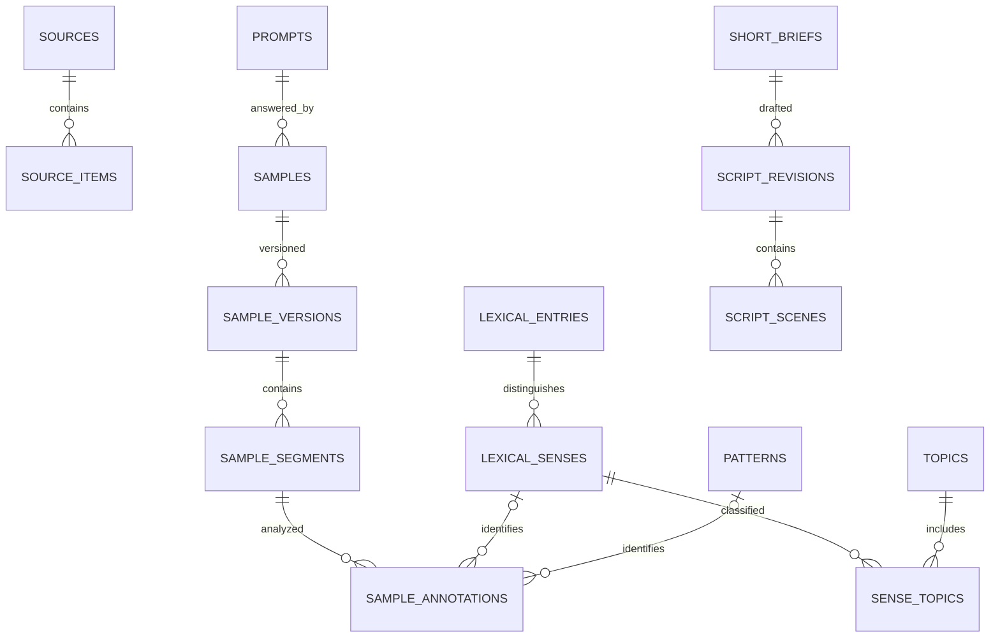

# IELTS Shorts — bộ chuẩn bị triển khai

Ngày: 2026-11-08. Trạng thái: có **lát cắt runtime đầu tiên**; [hướng dẫn và phần còn thiếu](runtime.md).
Schema/seed 29 bảng bên dưới vẫn là database thử độc lập, không phải schema runtime.

## Quyết định sản phẩm

- Nền tảng đầu ra: YouTube Shorts; bản đầu ưu tiên video dọc và duyệt thủ công.
- Kho kiến thức có chiều sâu; **một Short chỉ có một mục tiêu học và một đối tượng trọng tâm**.
- Từ vựng theo **nghĩa**, không chỉ theo từ; topic là quan hệ nhiều-nhiều.
- Cấu trúc gồm ngữ pháp, mẫu diễn đạt, cấu trúc tổ chức ý.
- Sample giữ riêng từng phiên bản và đoạn; liên kết đúng nghĩa từ/mẫu cấu trúc đang xuất hiện.
- Academic và General Training được phân biệt; Speaking/Listening có thể dùng chung.
- Nội dung và phong cách trình bày là hai chiều độc lập. Không gắn nhãn style là “trending” khi chưa khảo sát có thời điểm.
- Không gán band chính thức cho từ hoặc câu mẫu. Điểm sample phải có người/nguồn đánh giá và loại đánh giá.
- Không tự đăng YouTube. Upload/analytics hiện có chỉ nối sau, theo yêu cầu riêng.

## Tài liệu trong bộ này

- [Kế hoạch coding](implementation-plan.md): các mốc, module tái sử dụng, kiểm thử và điều kiện hoàn thành.
- [Từ điển dữ liệu](data-dictionary.md): quan hệ, quy tắc và phần chưa đưa vào prototype.
- [Schema SQL](schema.sql): schema SQLite dùng kiểm tra mô hình, không phải migration ứng dụng.
- [Dữ liệu mẫu](seed.sql): bản nháp tự biên soạn; không phải đề chính thức hoặc bài đã kiểm duyệt.
- [Hướng dẫn chuẩn bị data](data-preparation.md): nhập liệu theo lô, kiểm tra và bàn giao.
- [Kết quả kiểm tra prototype](validation.md): phạm vi và giới hạn kiểm tra đã chạy.
- [Playwright và kiểm tra tự động](../../test_suite/features/ielts/README.md): setup, lệnh chạy,
  baseline video thật, readiness gate và luồng thư viện → Short → MP4.



Sơ đồ chỉ hiển thị quan hệ chính; CHECK trong schema bảo đảm mỗi annotation chọn một loại,
và mỗi brief chọn một focus. Không phải mọi bảng đều cần xuất hiện ở UI hoặc được code cùng một mốc.

## Phạm vi database thử

Database thử tập trung taxonomy, từ vựng, cấu trúc, prompt, sample, bài tập và brief/script.
Không nhân bản `jobs`, `pipeline_revisions`, `media_assets`, `publish_attempts`,
`outcome_snapshots` của ứng dụng. `asset_references` chỉ minh họa tài sản thư viện trước khi tạo job;
không có file audio/video thật trong seed.

Mọi nội dung mẫu là `draft`; nguồn là `unverified`, quyền dùng là
`original_pending_review`. Không có nội dung mẫu được duyệt để xuất bản.
Thời lượng trong brief là mục tiêu biên tập, không phải thời lượng audio đã đo hoặc giới hạn của YouTube.

IDs dễ đọc trong seed là khóa ngoài cho dữ liệu chuẩn bị. Khi tích hợp, importer ánh xạ chúng sang UUID;
không thay ID cũ khi đổi tên topic/từ. Runtime có Alembic 0006 riêng; prototype này không tự cập nhật database app.

## Tạo lại database thử

Chạy từ root repository; Python standard library là đủ:

```bash
python - <<'PY'
import sqlite3
from pathlib import Path

folder = Path('docs/ielts-shorts')
output = Path('/tmp/ielts-shorts-prototype.sqlite')
if output.exists():
    raise SystemExit(f'File đã tồn tại: {output}; chọn tên mới để tránh ghi đè.')
with sqlite3.connect(output) as connection:
    connection.executescript((folder / 'schema.sql').read_text())
    connection.executescript((folder / 'seed.sql').read_text())
    assert not connection.execute('PRAGMA foreign_key_check').fetchall()
    assert connection.execute('PRAGMA integrity_check').fetchone()[0] == 'ok'
print(output)
PY
```

Các kết nối SQLite mới phải bật `PRAGMA foreign_keys=ON`.
Không chạy SQL prototype vào database đang dùng; integration dùng SQLAlchemy và Alembic riêng.
PostgreSQL là đích triển khai, nhưng **chưa được chạy/kiểm thử** trong bộ chuẩn bị này.

## Ví dụ truy vấn kho

Từ/cụm từ theo topic, trả về đúng nghĩa và tránh nhân bản headword:

```sql
SELECT e.headword, s.id AS sense_id, s.meaning_vi, s.review_status
FROM sense_topics st
JOIN lexical_senses s ON s.id = st.sense_id
JOIN lexical_entries e ON e.id = s.entry_id
JOIN topics t ON t.id = st.topic_id
WHERE t.code = 'online-learning'
ORDER BY e.headword, s.id;
```

Sample dùng một nghĩa cụ thể:

```sql
SELECT sa.title, sv.version, seg.text_en, a.note_vi
FROM sample_annotations a
JOIN sample_segments seg ON seg.id = a.segment_id
JOIN sample_versions sv ON sv.id = seg.sample_version_id
JOIN samples sa ON sa.id = sv.sample_id
WHERE a.sense_id = 'sense-self-paced';
```

Các brief tái sử dụng một kiến thức nhưng có mục tiêu/format riêng:

```sql
SELECT b.id, b.title, b.objective, b.format
FROM short_briefs b
LEFT JOIN exercises e ON e.id = b.focus_exercise_id
WHERE b.focus_sense_id = 'sense-access' OR e.sense_id = 'sense-access';
```

## Nguồn tham khảo cần xác minh lại

- IELTS.org: cấu trúc thi, tiêu chí, tài liệu mẫu.
- British Council Take IELTS và IDP IELTS: bài luyện và hướng dẫn.
- Cambridge IELTS, Official Cambridge Guide, Vocabulary/Grammar for IELTS: tham khảo sách.

Truy cập trực tiếp các website này trong phiên nghiên cứu bị policy mạng chặn.
Không khẳng định đã xác minh phiên bản, điều khoản hay xu hướng hiện tại.
Chưa nhập hoặc sao chép sách/đề/audio từ các nguồn này vào seed.
