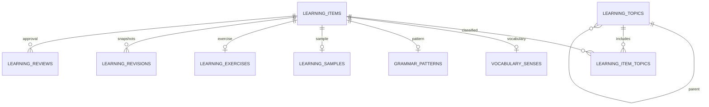

# Runtime IELTS library — first usable slice

The app now has a real **Thư viện IELTS** tab and migration **0006**. Run
`uv sync --frozen --group dev` and `uv run alembic upgrade head` before starting API/UI/worker.
No production database was migrated automatically by this coding task.

## Storage and workflow



Each item has one kind, a typed detail table, source/rights metadata, multiple topics,
a version and draft/reviewed status. Vocabulary is one **sense** per item, with lemma,
part of speech, UK IPA, definition and examples. Same lemma with different senses stays separate.
Patterns have form/function/explanation/examples. Samples have speaking/writing, prompt,
response and exact-quote annotations. Exercises have question/options/answer/explanation.
Examples/options/annotations use schema-validated JSON arrays, not unvalidated generic records.

Topic parents can be assigned on creation only; new nodes cannot introduce cycles. Topic names
are unique. Item editing, including source/rights, requires expected_version, resets draft and
keeps revision snapshots. Human approval records reviewer/note in the same transaction. This is
an editorial record, not an automated fact check or a verification of the asserted ownership.

Workflow: add topics → create/import draft → inspect knowledge and rights → approve item →
author one short excerpt/script (≤85 words, ≤650 characters) → create an English ContentPackage
→ existing job preflight/content review → white-card production → video review/download.
Only one item can be selected per brief request. A word limit is not a measured duration or
a semantic proof that the author wrote only one teaching point; keep editorial review.

Existing jobs retain a copy of the selected script and source; editing the library never silently
rewrites a previously created job. The package still uses the existing `novel` branch and shared
pipeline, not a new fake IELTS processing branch. No AI generation, automatic grading/band claim,
question-bank scraping, publication or music generation was added.

## Import and discovery

`POST /api/ielts/imports/preview` validates an entire typed batch and detects exact duplicate
content both in the DB and within the file. Schema errors are HTTP 422 with indexed validation
locations; topic/collection errors reject the request. `POST /api/ielts/imports` revalidates and
commits atomically; duplicates return 409 instead of silently changing data. Maximum 100 items.

```json
{
  "kind": "vocabulary",
  "items": [{
    "title": "adapt · a new situation",
    "topic_ids": ["<UUID returned by POST /api/ielts/topics>"],
    "source": {"label": "Original author", "rights_note": "Original draft — check before approval"},
    "data": {
      "lemma": "adapt", "part_of_speech": "verb", "sense": "change to suit a new situation",
      "ipa_uk": "/əˈdæpt/", "definition": "to change to suit a new situation",
      "examples": ["Students need time to adapt to a new school."]
    }
  }]
}
```

The quoted placeholder must be replaced with an actual topic UUID. Batch preview is available
in the UI before import. No external keys from the research prototype are automatically mapped.

Collection GET routes support topic/status filters and limit/offset pagination. RapidFuzz offers
case-insensitive, typo-tolerant title/lemma discovery over at most 1,000 newest filtered candidates;
`search_truncated` is explicit. It does not scan an arbitrarily large database or merge senses.
Listing uses two batched SELECTs, tested with 1 and 30 items. Topic filtering is for that exact node,
not implicit descendant expansion. UI editing currently retains topics; API PUT can change them.

## Scope left for the deeper design

The 29-table SQLite prototype remains an independent target design and has not been copied into
production. Runtime does not yet implement normalized prompts/segment links to vocabulary and
patterns, Academic/General Training taxonomy, reading/listening test sets, dataset import mappings,
series/spaced repetition, an independent on-screen-text timeline, quiz pauses/answer reveal or
full-text/vector indexes. These are distinct milestones, not completed by this first slice.
SQLite migration/API/browser checks are included; PostgreSQL runtime validation and production
size/latency benchmarks have not been performed. Do not claim large-scale capacity from query counts.

See [toolkit research](../research/shorts-toolkit/README.md),
[white-card rendering](../lesson-card.md) and [stock/music workflow](../study-pack.md).
